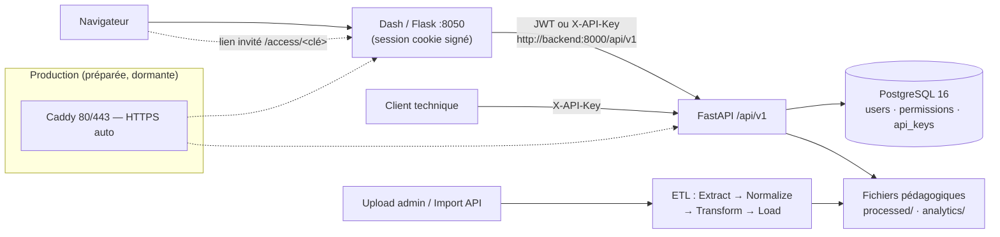

# 01 — Architecture

**Sommaire** : [Schéma global](#schéma-global) · [Composants](#composants) ·
[Deux stockages](#deux-stockages-séparés) · [Deux domaines](#deux-domaines-competence--curriculum) ·
[Cas Joint Degree UNITA](#cas-joint-degree-unita--scrl) · [Permissions](#permissions-par-source) ·
[Dashboard partagé](#mode-invité--dashboard-partagé) · [Registry ETL](#registry-etl) ·
[Contrats R4 & quality_report](#contrats-r4-et-quality_report)

## Schéma global



## Composants

| Composant | Rôle |
|---|---|
| **Frontend (Dash/Flask)** | Pages de visualisation + page Administration. Les données affichées passent par l'API avec le jeton de session. Porte aussi la route invitée `/access/<clé>`. |
| **Backend (FastAPI)** | Authentification, autorisations, service des données filtrées par source, routes admin, upload/import et déclenchement du pipeline. Routes métier sous `/api/v1`; `/health` non préfixé. Swagger actif en dev, désactivé en production. |
| **PostgreSQL** | Stockage uniquement des données d'authentification et d'autorisation : utilisateurs, permissions, clés API. Schéma géré par Alembic au démarrage du backend. |
| **ETL** | Transforme les fichiers bruts `raw/` en canonique `processed/`, tables plates `analytics/` et rapports qualité. Voir [06_ETL_DEVELOPER_GUIDE.md](06_ETL_DEVELOPER_GUIDE.md). |
| **Administration** | Section réservée aux admins : utilisateurs, permissions, clés API, upload/import de sources et relance pipeline. |
| **Caddy** | Reverse proxy HTTPS pour le mode production. Préparé, non utilisé dans le compose local standard. |

## Deux stockages séparés

```text
PostgreSQL  = QUI a accès À QUOI      (users, permissions, api_keys)
Fichiers    = LES DONNÉES elles-mêmes (data/processed, data/analytics)
```

Les données pédagogiques restent des fichiers JSON produits par l'ETL. Elles ne sont pas stockées dans PostgreSQL.

```text
data/
├── raw/{competence|curriculum}/{source}/FORMATION_fichier.ext
├── processed/{competence|curriculum}/{source}/FORMATION_processed.json
└── analytics/{competence|curriculum}/{source}/FORMATION_flat.json
                                                    FORMATION_quality.json
                                                    FORMATION_upsert_index.json (si source fusionnée)
```

## Deux domaines : competence / curriculum

La séparation est stricte : chaque fichier est traité dans un domaine, par un transformer de ce domaine.

### Domaine `competence`

Modèle principal : `app/models/competency_models.py`.

```text
ReferentielCompetences
→ SousClassification
→ Competence
→ NiveauDeveloppement
→ ApprentissageCritique
```

Un AC peut porter des références vers des modules avec :

```python
ac.modules: list[str]
```

Ces références sont des **codes**, pas des objets modules. Les objets modules réels appartiennent au curriculum.

### Domaine `curriculum`

Modèle principal : `app/models/curriculum_models.py`.

```text
Programme
→ PeriodeProgramme
→ GroupeElementsPedagogiques
→ ElementPedagogique
→ AcquisApprentissage
```

Le curriculum porte les vrais éléments pédagogiques : semestre, UE/groupe, ECTS, heures, enseignants, institution, acquis d'apprentissage associés à un module, etc.

### Invariant important

Ne pas mettre d'UE, d'ECTS, d'heures ou d'enseignants dans le domaine `competence`. Ne pas mettre de structure de référentiel dans le domaine `curriculum`.

## Institutions et formations multi-établissements

Le modèle curriculum contient la notion d'`institutions` au niveau du programme et des éléments pédagogiques. Elle permet de représenter des cas multi-établissements sans casser les sources existantes.

Classes disponibles :

```text
Institution
InstitutionDiplomante
InstitutionMobilite
```

Le champ `type` sert de discriminant. Une entrée sans `type` reste une institution générique.

## Cas Joint Degree UNITA / SCRL

La source `unita` illustre le cas d'un Joint Degree : une formation commune existe à deux niveaux.

| Niveau | Rôle | Exemple |
|---|---|---|
| **Générique** | Décrit le diplôme commun : PLO, MLO, modules génériques. | `UNITA_BUSINESS`, `UNITA_ECONOMICS`, `UNITA_M1` |
| **Institutionnel** | Décrit la maquette réelle d'un établissement. | modules `USMB_S1_E02`, `USMB_S3_E10`, etc. |

Le principe validé est :

```text
PLO / compétence
→ AC canonique construit depuis le PLO et le MLO
→ MLO hérité
→ module spécifique USMB
```

Il ne faut pas créer dans le modèle une relation métier directe :

```text
module USMB → module générique UNITA
```

La correspondance générique est seulement un mécanisme d'ETL pour transmettre les MLO vers `acquis_apprentissage` des modules spécifiques.

### Rôle de la colonne `Correspondance générique`

Dans l'Excel institutionnel USMB, la colonne `Correspondance générique` contient des valeurs lisibles :

```text
Business, Economics, Finance, HR, Marketing, Language B, Language C
```

Le normalizer résout ces valeurs vers des modules génériques UNITA. L'upsert curriculum copie ensuite les MLO du module générique dans les `acquis_apprentissage` du module spécifique. Une cellule vide signifie : **ne pas hériter de MLO**.

### Visualisation UNITA

Les visualisations ne doivent pas afficher le catalogue générique comme une vraie maquette institutionnelle. Elles utilisent deux chemins de jointure :

```text
Chemin classique : ac.modules → module curriculum
Chemin Joint Degree : module.acquis_apprentissage[MLO] → AC canonique PLO__MLO → compétence
```

Ainsi, les vues affichent les vrais modules USMB tout en conservant les liens vers les PLO.

## Cas USMB licence

Les fichiers `usmb_licence` sont des référentiels APC, pas des maquettes complètes. Ils contiennent les liens AC ↔ EC, les semestres et les UA, mais pas les ECTS/heures/enseignants complets. Le curriculum produit est donc un **curriculum-lite** : squelette fidèle à la source, avec les manques signalés dans le `quality_report`.

## Permissions par source

L'unité d'autorisation est la **source**, jamais le programme.

Exemples de sources :

```text
BUT
Polytech
usmb_licence
unita
```

Une permission = `(source, scopes)` où les scopes sont :

```text
read:competence
read:curriculum
read:analytics
*
```

La source `*` donne accès à toutes les sources actuelles et futures. Le filtrage est fait côté serveur.

## Mode invité / dashboard partagé

Une clé API de type `dashboard` génère un lien opaque `/access/<clé>`. Ce lien crée une session invitée en lecture seule, limitée aux sources de la clé. Une clé invitée n'est jamais admin.

## Registry ETL

Les factories sont déclaratives :

```text
(domain, source) → (module Python, classe)
```

Ajouter une source doit rester une opération localisée : normalizer, transformer(s), registry, tests et documentation.

## Contrats R4 et quality_report

Les contrats R4 définissent les sorties attendues des transformers : canonique + flat. Toute nouvelle source doit produire des données conformes au modèle et aux clés minimales attendues par les visualisations.

Le `quality_report` signale les manques ou ambiguïtés sans bloquer quand la donnée reste exploitable. Il doit bloquer seulement quand aucune donnée fiable ne peut être produite.

## Documents liés

- [03_UTILISATION.md](03_UTILISATION.md) : lecture des vues.
- [06_ETL_DEVELOPER_GUIDE.md](06_ETL_DEVELOPER_GUIDE.md) : règles pour ajouter ou maintenir une source.
- [10_JOINT_DEGREE.md](10_JOINT_DEGREE.md) : détail complet du cas UNITA / SCRL.
