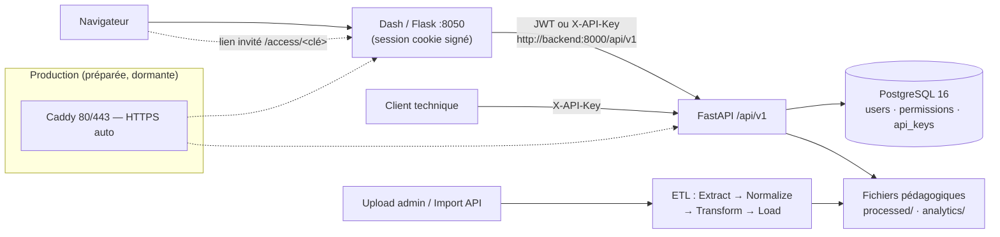

# 01 — Architecture

**Sommaire** : [Schéma global](#schéma-global) · [Composants](#composants) ·
[Deux stockages](#deux-stockages-séparés) · [Deux domaines](#deux-domaines-competence--curriculum) ·
[Permissions](#permissions-par-source) · [Dashboard partagé](#mode-invité--dashboard-partagé) ·
[Registry ETL](#registry-etl) · [Contrats R4 & quality_report](#contrats-r4-et-quality_report)

## Schéma global



## Composants

| Composant | Rôle |
|---|---|
| **Frontend (Dash/Flask)** | Pages de visualisation + page Administration. Ne lit JAMAIS le disque de données : tout passe par l'API avec le jeton de session. Porte la route invitée `/access/<clé>`. |
| **Backend (FastAPI)** | Authentification, autorisations, service des données (filtrées par source), routes admin, déclenchement du pipeline. Routes métier sous `/api/v1` ; `/health` non préfixé (monitoring/healthchecks). Swagger actif en dev, désactivé si `APP_ENV=production`. |
| **PostgreSQL** | Uniquement les données d'AUTHENTIFICATION (utilisateurs, permissions, clés API). Schéma géré par Alembic (`alembic upgrade head` à chaque démarrage du backend). |
| **ETL** | Transforme les fichiers bruts (`raw/`) en canonique (`processed/`) + tables plates (`analytics/`) + rapport qualité. Voir [06_ETL_DEVELOPER_GUIDE.md](06_ETL_DEVELOPER_GUIDE.md). |
| **Administration** | Section du frontend (admins uniquement) : utilisateurs, permissions, clés, upload/import de sources, relance du pipeline. |
| **Caddy** (production) | Reverse proxy HTTPS automatique (Let's Encrypt) devant frontend et backend. Préparé dans `docker-compose.prod.yml`, non actif en local. |

## Deux stockages séparés

```
PostgreSQL  = QUI a accès À QUOI      (users, permissions, api_keys)
Fichiers    = LES DONNÉES elles-mêmes (data/processed, data/analytics)
```

Les données pédagogiques ne sont **jamais** stockées en base SQL : ce sont des
fichiers JSON produits par l'ETL, organisés par `domaine/source/` :

```
data/
├── raw/{competence|curriculum}/{source}/FORMATION_fichier.ext
├── processed/…/FORMATION_fichier_processed.json    ← canonique (visualisations)
└── analytics/…/FORMATION_fichier_flat.json          ← table plate (analyse)
                 FORMATION_fichier_quality.json      ← rapport qualité (si produit)
```

## Deux domaines : competence / curriculum

La séparation est **stricte** (vérifiée par des tests dédiés) : chaque donnée
va vers SON modèle, chaque transformer ne traite que son domaine.

**Domaine `competence`** (modèles : `app/models/competency_models.py`) :

```
ReferentielCompetences → SousClassification → Compétence
    → ComposantesEssentielles
    → NiveauxDeveloppement (1..3) → ApprentissagesCritiques (AC)
```

Les AC peuvent porter des **références** vers des modules via `ac.modules` :
une liste de **codes** (chaînes), jamais des objets modules complets. C'est la
clé de jointure avec le curriculum (pattern identique au standard 1EdTech CASE).

**Domaine `curriculum`** (modèles : `app/models/curriculum_models.py`) :

```
Programme → PériodesProgramme (semestres) → Groupes (UE/UA)
    → Éléments pédagogiques (EC/modules : ECTS, CM/TD/TP/projet, type…)
```

Les modules **réels** (avec leurs attributs) appartiennent au curriculum.

**Cas USMB (important)** : les fichiers sources sont des *référentiels APC*,
pas des maquettes complètes. Ils contiennent compétences/niveaux/AC/liens
AC↔EC/semestres/UA, mais **ni ECTS, ni heures, ni coefficients, ni
enseignants**. En conséquence :

- domaine competence : **complet** ;
- domaine curriculum : **« lite »** — squelette Semestre → UA → EC avec
  ECTS/heures à `0.0`, explicitement signalé dans le `quality_report`
  (`curriculum_type: "lite"`). ⚠️ Ne jamais présenter ce curriculum-lite
  comme une vraie maquette.

## Permissions par source

L'unité d'autorisation est la **source** (`BUT`, `Polytech`, `usmb_licence`) —
jamais le programme. Une permission = (source, scopes) où les scopes sont
`read:competence`, `read:curriculum`, `read:analytics` ou `*`. La source `*`
donne accès à toutes les sources, actuelles et futures. La comparaison de
source est insensible à la casse. Le filtrage est fait **côté serveur** ; un
admin voit tout. Codes HTTP : `401` = non authentifié, `403` = authentifié
mais non autorisé.

## Mode invité / dashboard partagé

Une clé API de type `dashboard` génère un **lien opaque** `/access/<clé>`
(affiché une seule fois à la création). Ouvrir ce lien crée une session
invitée en lecture seule, limitée aux sources de la clé — utilisable par un
client (intranet, iframe) sans compte ni login. Une clé n'est jamais admin.

## Registry ETL

Les factories (`TransformerFactory`, `NormalizerFactory`) sont des **registres
déclaratifs** : `(domaine, source) → (module, classe)`, avec imports paresseux.
Ajouter une source = ajouter une entrée (une ligne). Une source inconnue est
refusée avec un message listant les couples supportés ; la page admin propose
dans son dropdown d'upload l'union des sources présentes dans les données et
des sources supportées par la registry.

## Contrats R4 et quality_report

- **Contrats R4** (`app/etl/transform/flat_contract.py`) : la spécification
  unique de ce que tout transformer doit produire — structure canonique
  (consommée par les visualisations) et clés obligatoires des tables plates.
  Des tests de contrat s'appliquent à chaque source ; toute nouvelle source
  doit les passer. Convention de codes compétence exigée par le frontend :
  `COMP_n` (tronc commun) / `COMP_<PARCOURS>_n` (parcours).
- **quality_report** : rapport produit par les sources qui le supportent
  (usmb_licence), sauvegardé dans `analytics/.../*_quality.json` — compteurs
  (compétences, AC, liens…), manques signalés (EC sans code, ECTS non
  renseignés…), warnings explicites. Il **signale sans bloquer**, sauf si
  aucune donnée exploitable n'est détectée.
